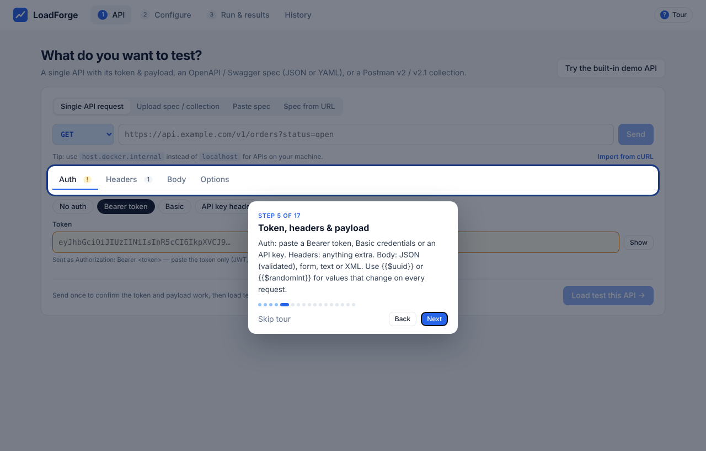
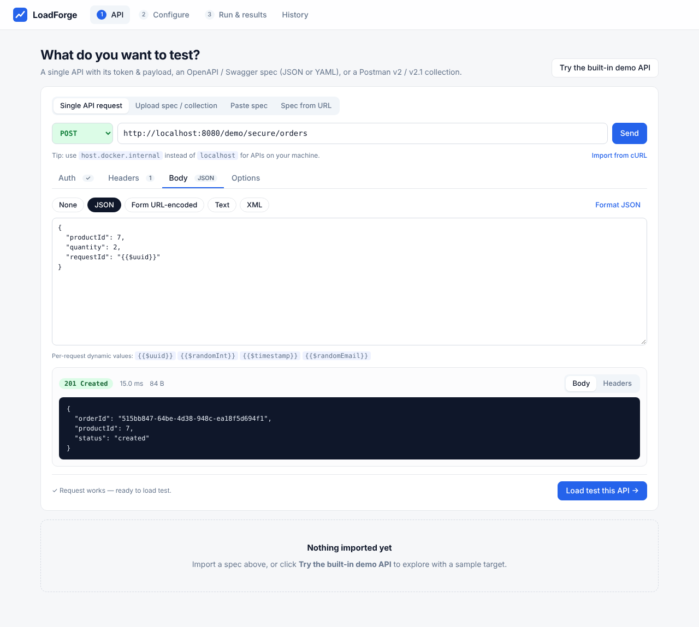
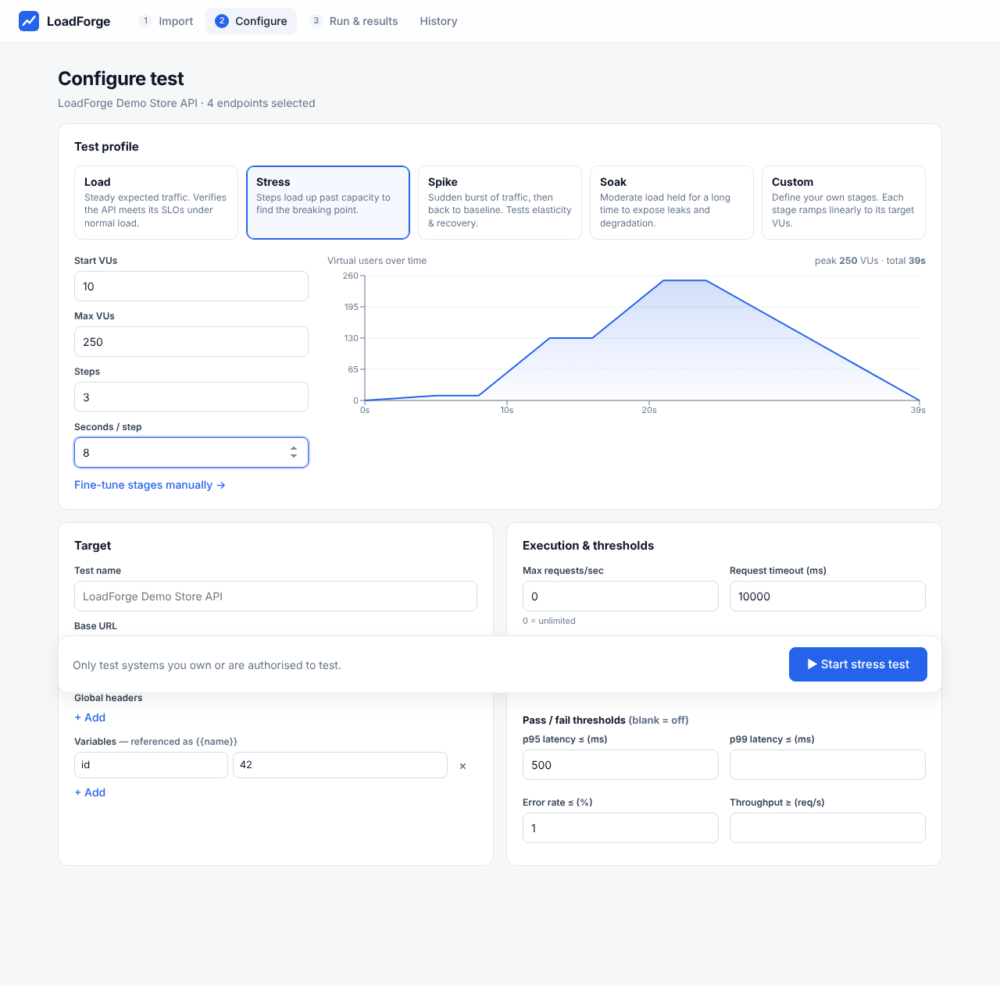
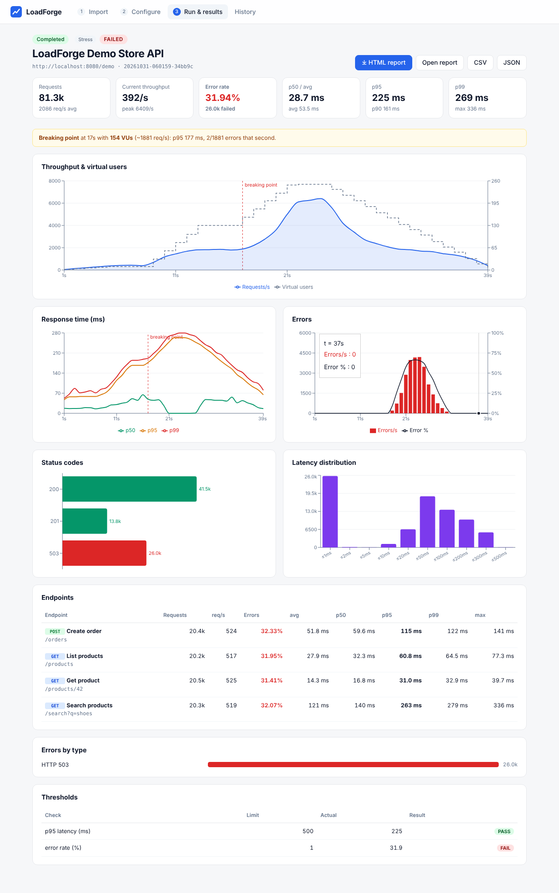
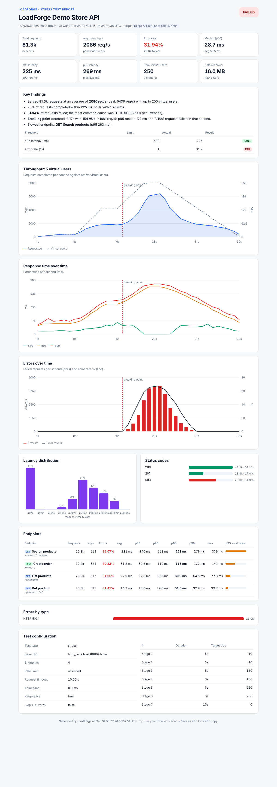

# LoadForge User Guide

LoadForge sends large numbers of requests to your API, measures how fast and how reliably it answers, and gives you a graphical report you can download and share.

**Contents**

1. [Install and start](#1-install-and-start)
2. [Your first test in two minutes](#2-your-first-test-in-two-minutes)
3. [Testing a single API](#3-testing-a-single-api)
4. [Importing OpenAPI, Swagger or Postman](#4-importing-openapi-swagger-or-postman)
5. [Configuring a test](#5-configuring-a-test)
6. [Watching a test run](#6-watching-a-test-run)
7. [Reports](#7-reports)
8. [History](#8-history)
9. [Reaching your API from Docker](#9-reaching-your-api-from-docker)
10. [Automating tests (CI)](#10-automating-tests-ci)
11. [Getting accurate results](#11-getting-accurate-results)
12. [Troubleshooting](#12-troubleshooting)
13. [Glossary](#13-glossary)

> Only test systems you own or are authorised to test. A load test can slow down or take down the target.

---

## 1. Install and start

**You need:** Docker with Docker Compose (Docker Desktop on Windows/macOS, or Docker Engine on Linux).

```bash
unzip loadforge.zip && cd loadforge
docker compose up -d --build
```

Open **http://localhost:3000**.

| Task | Command |
|---|---|
| Use another port | `LOADFORGE_PORT=8088 docker compose up -d` |
| Stop | `docker compose down` (your run history is kept) |
| Update after changes | `docker compose up -d --build` |
| View logs | `docker compose logs -f backend` |
| Delete all history | `docker compose down -v` (removes the `loadforge-data` volume) |
| Back up history | `docker run --rm -v loadforge_loadforge-data:/d -v $PWD:/b alpine tar czf /b/loadforge-backup.tgz -C /d .` |

The app has four screens, shown left to right in the top bar: **API → Configure → Run & results → History**.

## 2. Your first test in two minutes



1. On your first visit a **guided tour** starts automatically. It walks you through every screen in 17 short steps. Use **Next/Back**, the ← → keys, or **Esc** to leave. Replay it any time with the **? Tour** button at the top right.
2. Click **Try the built-in demo API**. This loads a small sample API that runs inside LoadForge, so you can practise without touching a real system.
3. Click **Configure test →**, choose **Stress**, then click **▶ Start stress test**.
4. Watch the charts fill in. The demo API is built to start failing above about 150 virtual users, so you will see a **breaking point**.
5. When the run finishes, click **⤓ HTML report**.

## 3. Testing a single API

Use this when you want to test one endpoint with its own token and payload, without a spec file. It is the first tab on the **API** screen: **Single API request**.



### 3.1 Method and URL

Choose the method (GET, POST, PUT, PATCH, DELETE, HEAD, OPTIONS) and type the **full URL**, including any query string:

```
https://api.example.com/v1/orders?status=open
```

If the API runs on your own computer, use `http://host.docker.internal:PORT/...`, not `localhost`. See [section 9](#9-reaching-your-api-from-docker) for why.

### 3.2 Auth tab

| Option | What is sent | Use for |
|---|---|---|
| **No auth** | nothing | public endpoints |
| **Bearer token** | `Authorization: Bearer <token>` | JWT, OAuth 2 access tokens, most modern APIs |
| **Basic** | `Authorization: Basic base64(user:password)` | username/password APIs |
| **API key header** | `<Header-Name>: <key>` (default `X-API-Key`) | API-key APIs |

Paste only the token itself. If you include the word `Bearer`, it is removed so it is not sent twice. Secret fields are hidden; click **Show** to check what you typed. The tab shows a **!** while a required token is empty.

> Tokens expire. A token that expires during a long test makes every later request fail with **401**. Use a token that lasts longer than the test.

### 3.3 Headers tab

Add any extra headers, such as `Accept`, `X-Tenant-Id` or `X-Request-Source`. Below the editor, **Headers that will be sent** lists the final set, including the auth header and Content-Type. Secret values are shortened there.

### 3.4 Body tab

| Type | Content-Type added automatically |
|---|---|
| None | – |
| JSON | `application/json` |
| Form URL-encoded | `application/x-www-form-urlencoded` (write `a=1&b=2`) |
| Text | `text/plain` |
| XML | `application/xml` |

- JSON is checked as you type. Invalid JSON is outlined in red, and **Format JSON** tidies it.
- If you set your own `Content-Type` header, yours is used instead.
- GET and HEAD requests are sent without a body. You are warned if you add one.

**Values that change on every request.** Write these anywhere in the URL, headers or body:

| Placeholder | Example value |
|---|---|
| `{{$uuid}}` (also `{{$guid}}`) | `3f2c…-…` (new each request) |
| `{{$randomInt}}` | `0`–`999` |
| `{{$timestamp}}` | `1793431234` (Unix seconds) |
| `{{$isoTimestamp}}` | `2026-10-31T06:00:00Z` |
| `{{$randomEmail}}` | `user48213@example.com` |
| `{{$randomBoolean}}` | `true` / `false` |

Example: an order body that is not rejected as a duplicate:

```json
{ "productId": 7, "quantity": 2, "requestId": "{{$uuid}}" }
```

### 3.5 Options tab

- **Expected status codes:** a comma-separated list, for example `201` or `200, 204`. Leave it blank and any status below 400 counts as success. Set it when your API returns 200 for errors, or when only one specific code is correct.
- **Skip TLS verification:** for test servers with self-signed HTTPS certificates.

### 3.6 Import from cURL

Click **Import from cURL** and paste a command. Your browser can produce one: DevTools → Network → right-click a request → **Copy → Copy as cURL (bash)**. Postman can too (Code → cURL). LoadForge fills in the method, URL, Bearer or Basic token, headers, body, cookies and `-k` (skip TLS).

### 3.7 Send, then load test

1. Click **Send** (or press Enter in the URL box). LoadForge makes **one real request from the same place the load test will run from**, then shows the status, time, size, and the formatted response body and headers.
2. Fix anything that is wrong. A **401/403** warning means the API rejected the credentials, and a load test would fail the same way.
3. Click **Load test this API →** to configure the test for this one request. If you have already imported a spec or collection, **Add to "…"** adds this request alongside those endpoints instead.

Your request is remembered in the browser, including the token. On a shared computer, clear the token when you are done.

## 4. Importing OpenAPI, Swagger or Postman

On the **API** screen, choose **Upload spec / collection** (drag a file onto the box), **Paste spec**, or **Spec from URL** (for example `https://api.example.com/openapi.json`).

| Format | Versions | File types |
|---|---|---|
| OpenAPI | 3.0, 3.1 | JSON, YAML |
| Swagger | 2.0 | JSON, YAML |
| Postman collection | v2.0, v2.1 (export via *Export → Collection v2.1*) | JSON |

**What gets imported**

- Every operation becomes an endpoint, grouped by tag (OpenAPI) or folder (Postman).
- **Base URL** comes from `servers` (OpenAPI), `host` + `basePath` (Swagger), or the common start of the URLs (Postman).
- **Path parameters** such as `/users/{id}` or Postman `:id` become variables like `{{id}}`, using the example value from the spec or `1`.
- **Required query parameters** are added with example values.
- **Request bodies** come from the spec's examples. If there are none, a sample is built from the schema, following `$ref`, `allOf` and `oneOf`.
- **Auth**: security schemes and Postman auth become headers such as `Authorization: Bearer {{token}}`. Fill in the `token` variable on the Configure screen; empty variables are highlighted.
- Postman variables, headers (except disabled ones), raw, urlencoded, form-data (text fields) and GraphQL bodies are all imported.

**Choosing and editing endpoints**

- Tick the endpoints to include. **Select all / None** apply to whatever the filter box currently shows.
- **Weight** sets each endpoint's share of the traffic. With weights 3 and 1, the first gets about 75% of requests. Use it to mimic real traffic, for example many reads and few writes.
- Click an endpoint to edit its method, path or URL, headers (JSON), body, and expected status codes.

## 5. Configuring a test



### 5.1 Test types

| Type | What it does | Use it to answer |
|---|---|---|
| **Load** | Ramps up to N users, holds, then ramps down | "Does the API meet its targets at normal traffic?" |
| **Stress** | Raises users in steps, from a start number up to a maximum | "How much can it take, and where does it break?" |
| **Spike** | Normal traffic, then a sudden jump, then back to normal | "Does it survive a burst, and does it recover?" |
| **Soak** | Moderate traffic for a long time (minutes to hours) | "Do memory leaks or slow degradation appear over time?" |
| **Custom** | Your own list of stages | anything else |

**Virtual users (VUs)** are simulated clients. Each one sends a request, waits for the answer, optionally pauses (think time), and repeats. More VUs means more requests in flight at the same time. Throughput (requests per second) depends on how fast the API answers: 50 VUs against a 50 ms endpoint gives roughly 1,000 requests per second.

**Stages.** Each stage moves the number of VUs in a straight line to its target over its duration. The chart on the right shows exactly what will run, with the peak VUs and total duration. Click **Fine-tune stages manually →** to switch to Custom with the current stages loaded.

Suggested starting points:

| Goal | Settings |
|---|---|
| Quick check | Load · 10 VUs · ramp 10 s · hold 60 s |
| Normal traffic | Load · your expected number of users · ramp 30 s · hold 5–10 min |
| Find the limit | Stress · start 10 · max 2–5× expected · 5–8 steps · 60 s per step |
| Black Friday | Spike · normal traffic → 10× normal for 1 min |
| Leak hunt | Soak · about 60% of capacity · 1–4 hours |

### 5.2 Target

- **Test name** appears on the report and in History.
- **Base URL**: change this to point the same test at staging, QA or production.
- **Global headers** are added to every request, for example `Authorization: Bearer {{token}}`.
- **Variables** are values used as `{{name}}` in URLs, headers and bodies. Variables that look like secrets (token, key, auth, password) are highlighted when empty.

### 5.3 Execution and thresholds

| Setting | Meaning |
|---|---|
| Max requests/sec | Caps total throughput no matter how many VUs. `0` means unlimited. Use it to send exactly N requests per second. |
| Request timeout | A request taking longer than this counts as an error (`timeout`). |
| Think time per VU | Pause after each response, to imitate real users who don't click instantly. |
| HTTP keep-alive | Reuse connections (on by default, like real clients). Turn it off to measure the cost of opening a new connection each time. |
| Skip TLS verification | Accept self-signed certificates. |

**Thresholds** decide whether the test **PASSED** or **FAILED**. Leave a box blank to ignore it.

| Threshold | Passes when |
|---|---|
| p95 latency ≤ X ms | 95% of requests answered within X ms |
| p99 latency ≤ X ms | 99% answered within X ms |
| Error rate ≤ X % | failed requests are at most X% |
| Throughput ≥ X req/s | average throughput reached X |

Click **▶ Start … test**. The test runs on the server, so you can close the browser and come back later.

## 6. Watching a test run



- **Progress bar**: elapsed time, total time, and active VUs.
- **Summary tiles**: total requests, current and peak throughput, error rate, p50, p95, p99, and max response time.
- **Throughput & virtual users**: requests per second (blue area) against VUs (dashed). If throughput stops rising while VUs keep increasing, the API has hit its limit.
- **Response time**: p50, p95 and p99 per second. A widening gap between p50 and p99 means some requests are queuing.
- **Errors**: failed requests per second (bars) and error % (line).
- **Status codes**: green 2xx, blue 3xx, amber 4xx, red 5xx or connection errors (`ERR`).
- **Latency distribution**: how many requests fell into each response-time bucket.
- **Endpoints**: the same numbers for each endpoint, to find the slow one.
- **Errors by type**: for example `HTTP 503`, `timeout`, `connection refused`, `TLS error`.

Click **■ Stop test** to end early. Results so far are kept and the run is marked *stopped*.

## 7. Reports

When a run finishes, the buttons at the top right become **⤓ HTML report**, **Open report**, **CSV** and **JSON**. The same downloads are in History.



| Format | Contents | Use for |
|---|---|---|
| **HTML** | Verdict, 8 summary tiles, key findings in plain English, thresholds, throughput/latency/error charts, latency distribution, status codes, endpoint table, error breakdown, full test configuration | Sharing with your team or managers. A single file that works offline with no internet. **Print → Save as PDF** gives a clean PDF. |
| **CSV** | One row per second (VUs, requests, errors, rps, avg/p50/p95/p99/max, bytes), then one row per endpoint | Excel or Sheets, your own charts, comparing runs |
| **JSON** | Everything: configuration, time series, summaries | Automation and dashboards |

**Reading the numbers**

- **p50 / p95 / p99**: 50%, 95% or 99% of requests were faster than this. p95 and p99 reflect what your slowest users experience. They matter more than the average.
- **Error rate**: requests that got a status of 400 or above (or not in your expected codes), timed out, or could not connect.
- **Breaking point**: the first second, after the warm-up, where errors went above 5% or p95 became more than 3× the starting level. The VUs and requests per second at that moment are roughly your capacity. The point is marked with a red dashed line on the charts.
- Latency covers everything from sending the request to reading the full response, as seen by the load generator.

## 8. History

**History** lists every run, newest first, with status, request count, throughput, p95, error % and PASS. Click a row to open its full results. Use **⤓ HTML** or **CSV** to download, and 🗑 to delete. Runs are stored in the `loadforge-data` Docker volume and survive restarts and upgrades.

## 9. Reaching your API from Docker

The load comes from the **LoadForge backend container**, not from your browser. Inside a container, `localhost` means that container itself.

| Where your API runs | URL to use |
|---|---|
| Internet, cloud, company server | its normal URL, e.g. `https://api.example.com` |
| Your own computer | `http://host.docker.internal:PORT` |
| Another Docker container | the service name on a shared Docker network, e.g. `http://orders-api:8080` |
| The built-in demo | `http://localhost:8080/demo/...` (it lives inside the backend container) |

Your API must listen on **all interfaces** (`0.0.0.0`), not only `127.0.0.1`, or it will refuse connections from Docker. On Linux, the compose file already maps `host.docker.internal` for you.

To share a network with another compose project, add to the backend service:

```yaml
    networks: [default, other_project_default]
networks:
  other_project_default:
    external: true
```

## 10. Automating tests (CI)

Expose the backend by uncommenting `ports: - "8080:8080"` in `docker-compose.yml`. Then:

```bash
# 1. Check one request works
curl -s -X POST localhost:8080/api/try -H 'Content-Type: application/json' -d '{
  "method":"POST","url":"https://staging.example.com/orders",
  "headers":{"Authorization":"Bearer '"$TOKEN"'","Content-Type":"application/json"},
  "body":"{\"productId\":7}"}'

# 2. Start a test (config.json has the same fields the UI sends)
ID=$(curl -s -X POST localhost:8080/api/runs -H 'Content-Type: application/json' -d @config.json | jq -r .id)

# 3. Wait, then fail the pipeline if thresholds failed
while [ "$(curl -s localhost:8080/api/runs/$ID | jq -r .status)" = running ]; do sleep 5; done
curl -s -o report.html "localhost:8080/api/runs/$ID/report/html?download=1"
curl -s localhost:8080/api/runs/$ID | jq -e '.summary.passed' > /dev/null
```

Minimal `config.json` for a single endpoint:

```json
{
  "name": "Orders API – nightly",
  "type": "load",
  "baseUrl": "https://staging.example.com",
  "headers": { "Authorization": "Bearer {{token}}" },
  "variables": { "token": "…" },
  "endpoints": [{ "id": "e1", "name": "Create order", "method": "POST", "path": "/orders",
                  "headers": { "Content-Type": "application/json" },
                  "body": "{\"productId\":7,\"requestId\":\"{{$uuid}}\"}", "weight": 1, "enabled": true }],
  "stages": [{ "durationSec": 30, "targetVus": 50 }, { "durationSec": 300, "targetVus": 50 }, { "durationSec": 10, "targetVus": 0 }],
  "timeoutMs": 10000, "keepAlive": true,
  "thresholds": { "p95Ms": 500, "errorRatePct": 1 }
}
```

The full API list is in the README.

## 11. Getting accurate results

- **The load generator must not be the bottleneck.** If the backend container's CPU stays above about 80% (`docker stats`), your numbers reflect LoadForge's limits, not your API's. Give it more CPUs, or run it on a separate machine close to the API.
- **Test from a realistic network position**: the same region or data centre as your real users, or the same network as the API if you only want server capacity.
- **Warm up**: the first seconds include connection setup and cold caches. Use a ramp-up and focus on the steady part.
- **Use realistic data**: use `{{$uuid}}` and similar placeholders so caches and duplicate checks behave as in production, and weights to mimic the real mix of traffic.
- **Mind side effects**: POST and DELETE tests create or remove real data. Use a test environment or test accounts.
- **Rate limits and WAFs** may block you (HTTP 429 or 403). Allow-list the test machine, or test behind the limiter.
- One LoadForge instance supports up to 20,000 VUs and up to 3 tests running at the same time.

## 12. Troubleshooting

| Symptom | Likely cause and fix |
|---|---|
| `connection refused` with `localhost` | Inside Docker, localhost is LoadForge. Use `host.docker.internal` ([section 9](#9-reaching-your-api-from-docker)). |
| `connection refused` with `host.docker.internal` | Your API is bound to 127.0.0.1. Start it on `0.0.0.0`. |
| `DNS lookup failed` | Wrong hostname, or a private/VPN name the container can't resolve. Use an IP address or fix Docker's DNS. |
| Every request is **401/403** | Token missing, expired or malformed. Re-check the Auth tab with **Send**. |
| Every request is **400** | Payload doesn't match what the API expects. Compare the body against a working request from Postman or cURL. |
| Many **429** | The API's rate limiter is working. Lower **Max requests/sec** or allow-list LoadForge. |
| `TLS error` | Self-signed or internal certificate. Tick **Skip TLS verification**. |
| `timeout` | Slower than the request timeout. Raise the timeout or investigate the API. |
| `too many open files` | Too many connections for the OS. The compose file sets 65,535; keep keep-alive on. |
| Throughput flat while VUs rise | You found the capacity limit, or the load generator is saturated. Check `docker stats`. |
| Live charts don't update behind your own proxy | That proxy buffers Server-Sent Events. Disable buffering for `/api/runs/*/stream` (see `frontend/nginx.conf`). |
| YAML spec won't import | Validate it at editor.swagger.io. Only `openapi:`/`swagger:` specs and Postman v2 collections are supported. |
| The tour doesn't start | It only starts automatically on the first visit. Click **? Tour**. |

## 13. Glossary

| Term | Meaning |
|---|---|
| **VU (virtual user)** | A simulated client sending requests one after another |
| **Stage** | A period in which VUs move linearly to a target count |
| **RPS / throughput** | Completed requests per second |
| **Latency / response time** | Time from sending a request to receiving its full response |
| **p50 / p95 / p99** | Percentiles: the time within which 50%, 95% or 99% of requests completed |
| **Error rate** | Share of requests that failed (bad status, timeout, connection error) |
| **Threshold** | A pass/fail rule applied to the final results |
| **Breaking point** | The load level at which errors or latency suddenly get much worse |
| **Load / stress / spike / soak** | Normal traffic / increasing until failure / sudden burst / long duration |
| **Think time** | A pause between a VU's requests, to imitate real users |
| **Keep-alive** | Reusing the same connection for many requests |
